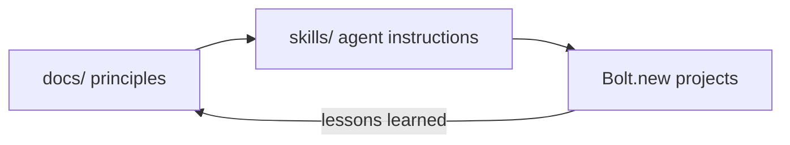

# Docs — Knowledge Base

Background knowledge behind the skills in this repo. Skills (`*/SKILL.md`) are short, imperative instructions for the coding agent. These docs are the **why**: categories, principles, and precepts, written for the human designer (and readable by agents when deeper context helps).

## Objectives

1. **Make and understand FUN** — learn what makes play engaging by rebuilding and reimagining classic designs, and apply that understanding to gamification.
2. **Sharpen 2D/3D visualization skills** — boards, maps, and side-scrolling worlds are the same problems clients have: showing data, plans, territories, and scenarios clearly and interactively.
3. **Stay original** — borrow design *principles* from classics, never their protected *expression*.

## Index

| Doc | What it covers |
|---|---|
| [dataviz-first-principles.md](dataviz-first-principles.md) | First-principles 2D & 3D data visualization guide: taxonomy of charts/diagrams, perceptual channel hierarchy, OkLCH color science, 2D vs 3D tradeoffs, mobile/desktop/TV/print adaptation, and Ark UI architecture |
| [fun-and-design-principles.md](fun-and-design-principles.md) | Frameworks for fun (MDA, kinds of fun, flow, core loops, feedback), precepts for designing play |
| [game-taxonomy.md](game-taxonomy.md) | Classification of games and mechanics; where each target project fits |
| [originality-and-ip.md](originality-and-ip.md) | Idea vs expression, trademarks, trade dress; a repeatable reimagining process |
| [board-to-3d.md](board-to-3d.md) | Principles for turning 2D boards/maps into legible, delightful 3D scenes |
| [visualization-for-consulting.md](visualization-for-consulting.md) | Transferring game techniques to client dashboards, maps, plans, and scenario tools |
| [gamification.md](gamification.md) | Applying game design to non-game products, ethically |
| [game-studies/](game-studies/) | Design teardowns + original reimagining seeds: chess, hidden-identity skirmish (Stratego-like), territory conquest (Risk-like), jungle runner (Pitfall-like) |

## How docs relate to skills

When a project teaches something durable, add it here first, then distill the actionable part into a skill.

> These docs are general design knowledge, not legal advice. For commercial releases, consult an IP attorney.
