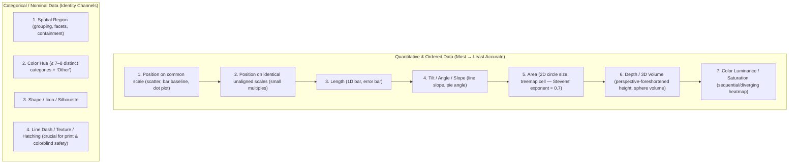
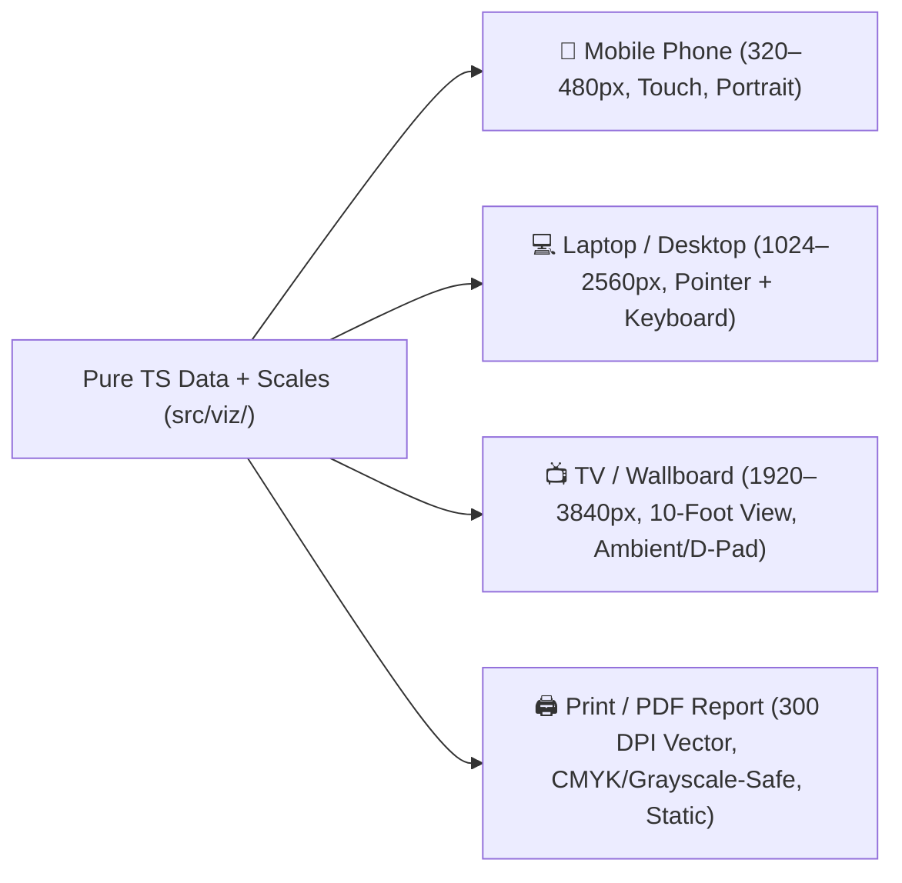

# First-Principles Data Visualization Guide

A designer's and engineer's reference for turning raw numbers, topologies, and spatial models into truthful, immediate visual insight across 2D, 3D, and every display medium (mobile, desktop, TV, print).

---

## 1. Overview: Categories & Taxonomy of Visualizations

Before choosing a library or rendering API, classify *what kind of relationship* the audience needs to perceive.

### 1.1 Primary 2D Chart & Diagram Families

| Category | Core Question | Canonical 2D Forms | Key Visual Channels | When it Fails / Alternatives |
|---|---|---|---|---|
| **Comparison (Categorical)** | *How do discrete groups compare in magnitude?* | Horizontal/vertical bar chart, Cleveland dot plot, lollipop, grouped/layered bars, Marimekko, radar/spider | Aligned length/position (1D), y-order (ranked), color hue (group) | Radar distorts area and order; prefer small-multiple bars or parallel coordinates. Never truncate bar baselines. |
| **Temporal & Trend** | *How do values evolve, cycle, or shift over time?* | Line chart, area chart, sparkline, step chart, horizon chart, streamgraph, candlestick/OHLC, Gantt, calendar heatmap | Horizontal position ($x = t$), vertical position ($y$), slope (rate of change), band height | > 5 overlapping lines become "spaghetti" — split into small multiples or highlight 1 focal series against muted context. |
| **Distribution & Uncertainty** | *What is the shape, spread, skew, or confidence of the data?* | Histogram, box-and-whisker, violin plot, kernel density (KDE), ridgeline (joyplot), beeswarm, strip plot, ECDF, Q-Q plot, fan chart, error bars / confidence intervals | Position + extent along axis, vertical density/width, opacity gradient (CI bands) | Box plots hide multimodality; pair with jittered points, beeswarm, or half-violin (raincloud plot). |
| **Correlation & Multivariate** | *How do two or more continuous/categorical variables covary?* | Scatterplot, bubble chart ($x, y, r, \text{color}$), hexbin / 2D density contour, SPLOM (scatterplot matrix), parallel coordinates, correlogram / heatmap | 2D position ($x, y$), area ($r \propto \sqrt{v}$), color saturation/luminance | Overplotting above ~1,000 points — switch to hexbin, contour, or WebGL instanced points with alpha blending. |
| **Part-to-Whole & Hierarchical** | *How does a total break down into nested components?* | Stacked bar (100% or absolute), treemap, icicle / partition chart, sunburst, Waffle chart (10×10 grid), Pareto chart, Voronoï treemap | Area (2D), shared baseline (first stack segment), nesting depth / containment | Pie/donut charts fail above 3–4 slices (angle/area judgment is weak). Use treemaps for nested hierarchies or ranked bars for exact comparison. |
| **Flow, Network & Relational** | *How do entities connect, cluster, or transfer volume?* | Node-link graph (force-directed, layered/DAG), Sankey / alluvial diagram, chord diagram, adjacency matrix, arc diagram | Link width (flow volume), spatial proximity (clustering), containment/order, matrix cell shade | Force-directed hairballs above ~150 nodes — switch to adjacency matrix (seriated/reordered) or hierarchical edge bundling. |
| **Spatial & Geographic (2D)** | *Where do phenomena occur across physical or logical space?* | Choropleth, proportional symbol map, dot-density map, hex/grid cartogram, isochrone/isolines (contours), origin-destination flow map, floor/site plan | Projected 2D coordinates ($\lambda, \phi$), color ramp, symbol area, contour lines | Raw count choropleths mirror population density — always normalize (per capita, rate, density) or use proportional symbols / cartograms. |
| **Process, Set & Conceptual Diagrams** | *How does a system, architecture, or set intersection work?* | Architecture/state/sequence diagram, DAG workflow, Euler/Venn, UpSet plot (for $>3$ sets), decision tree, causal loop diagram | Topological connectivity, directed arrows, spatial grouping / swimlanes, aligned intersection matrix | Venn diagrams break past 3 sets — use an UpSet plot (matrix + aligned bars). |
| **Tabular & Hybrid Micro-Views** | *How do we support both exact lookup and pattern scanning?* | Heat-table, table with inline bars/sparklines/bullet graphs, pivot matrix | Alignment, tabular numerals, cell fill luminance, embedded 1D length | Plain number walls obscure outliers — embed subtle bar fills or sparklines inside cells. |

### 1.2 3D Visualization Taxonomy (When & What to Build)

3D introduces **perspective foreshortening**, **occlusion**, and **viewpoint dependency**. A 3D bar chart on a flat screen is almost always worse than a 2D one; a 3D site model, molecular structure, or terrain elevation map is indispensable.

| 3D Category | Canonical 3D Forms | Why 3D Earns Its Keep | Crucial Companion View |
|---|---|---|---|
| **Extruded Spatial / Priscilla Maps** | Prism choropleth (`ExtrudeGeometry`), 3D hexbin spikes, 3D origin-destination arcs on a globe or plane | Separates two variables spatially: base color = rate/category, extrusion height = volume/total; globe arcs avoid projection distortion at planetary scale | Synchronized 2D ranked bar chart + orthographic top-down camera toggle |
| **Terrain, Bathymetry & Continuous Surfaces** | DEM heightfields, 3D response surfaces $z = f(x, y)$, contour-draped meshes, loss landscapes | Humans intuitively read hills, valleys, saddle points, and gradients when lit with directional + ambient light and contour lines | 2D contour/heatmap slice and cross-sectional profile ($z$ vs $x$ cut line) |
| **Architectural, Site & Digital Twin Models** | 3D floor plans, multi-story facility cutaway, warehouse slotting, infrastructure/utility layers | Physical verticality (floors, racks, underground pipes, line-of-sight) cannot be flattened without losing spatial adjacency | Floor-selector exploded view + 2D schematic plan per level |
| **Volumetric & Scientific Fields** | Voxel grids, isosurfaces (marching cubes), 3D streamlines / vector fields, point clouds (LiDAR) | Data is intrinsically $3\text{D}$ ($x, y, z, v$) | Orthogonal slicing planes (XY, XZ, YZ cross-hairs) + transfer-function histogram |
| **3D Multivariate & Embedding Spaces** | 3D scatter / UMAP / t-SNE / PCA clusters, 3D force-directed graphs | Motion parallax (slow orbit or user drag) resolves cluster separation across 3 principal components | 2D projection facets (XY, XZ, YZ shadows on bounding box walls) + lasso selection table |
| **Tangible Scenario & Tabletop Models** | Token stacks on territory boards, timeline tracks in 3D space (see [board-to-3d.md](board-to-3d.md)) | Physical presence, camera choreography ("scrollytelling" focus moves), shared workshop engagement | 2D HUD summary cards and deterministic history log |

---

## 2. First Principles of Visual Encoding

Every visualization is a mathematical function $V: \text{Data} \to \text{Marks} \times \text{Channels}$. Designing from first principles means respecting human visual perception and information theory.

### 2.1 Preattentive Processing & the Channel Hierarchy

Following Bertin (*Semiology of Graphics*), Cleveland & McGill's psychophysical experiments, and Munzner (*Visualization Analysis and Design*), visual channels are strictly ordered by how accurately the human visual system decodes them.

**Design laws from the hierarchy:**
1. **Map the most important variable to position** ($x$ or $y$ on a shared baseline).
2. **Never map quantitative values to color hue** (rainbow colormaps create false boundaries); use perceptually uniform luminance/chroma ramps (OkLCH, Viridis, Cividis, Magma, or ColorBrewer sequential/diverging).
3. **Size circles by area, never radius**: $r = k \sqrt{\text{value}}$, never $r = k \cdot \text{value}$ (which squares the perceived ratio).
4. **Proportional Ink Principle** (Tufte / Bergstrom & West): when a shaded area or bar represents a magnitude, its visual extent must be proportional to the numerical value. **Bar and area charts must start at $0$**; line and dot plots may narrow their axis range to show domain-relevant variation, provided the axis range is clearly labeled.

### 2.2 Gestalt Principles of Grouping

How viewers parse structure before reading a single label:
- **Proximity**: place related series, legends, and annotations directly adjacent to their data marks.
- **Similarity**: items sharing hue, shape, or stroke weight are read as a cohort.
- **Enclosure & Common Region**: subtle background bands (e.g., recession shading, target zones, continent plinths) group marks effortlessly.
- **Connection**: lines connecting points imply continuity or sequence (never connect unordered categorical points with a line).
- **Figure–Ground**: data marks are the *figure* (high contrast, crisp); grids, axes, and map base layers are the *ground* (low contrast, muted).

### 2.3 Color Science, OkLCH & Accessibility

- **Perceptual uniformity**: build palettes in **OkLCH** (`oklch(L C H)`) so equal steps in data produce equal steps in perceived lightness $L$.
- **Three palette archetypes**:
  1. **Sequential** (low → high): monotonic lightness $L$ shift (e.g., light tint → deep saturated shade).
  2. **Diverging** (negative ← neutral midpoint → positive): two distinct hues meeting at a neutral desaturated zero/target midpoint (e.g., Teal ↔ Warm Gray ↔ Amber/Rust).
  3. **Categorical / Qualitative**: distinct hues at similar perceived lightness so no category screams louder by accident; reserve one high-chroma accent color for the focal callout and mute context series into slate/gray.
- **Color-vision deficiency (CVD) & redundant encoding**: ~8% of males have red-green CVD (deuteranopia/protanopia). Never rely on red vs. green alone — pair hue with **luminance difference**, **direct labels**, **point shapes**, **dash patterns**, or **SVG pattern fills**.

### 2.4 Data-Ink, Annotation & Narrative Hierarchy

- **Data-ink maximization**: strip non-data chrome (heavy 3D bevels, dark drop shadows on bars, dual-axis spaghetti, redundant legends when direct line labels fit). Keep light gridlines (`opacity: 0.12–0.2`) when readers need to trace values across wide spans.
- **Action titles & annotation layer**: title the chart with the *finding* ("Q3 Churn Dropped 18% After Onboarding Redesign"), subtitle with the metric and units ("Monthly cohort attrition rate, %, Jan 2024 – Sep 2026"), and place callout annotations directly on inflection points, anomalies, and thresholds.
- **Shneiderman's Mantra**: *Overview first, zoom and filter, then details-on-demand* — pair macro summary views with interactive cross-filtering (via Ark UI controls) and rich focus/hover inspection.

---

## 3. First Principles of 2D vs. 3D Visualization

| Dimension | 2D Plane (SVG / Canvas) | 3D Scene (WebGL / R3F) | Hybrid / Linked Best Practice |
|---|---|---|---|
| **Position accuracy** | Exact — uniform pixel scale across the entire viewport | Foreshortened by perspective ($\propto 1/z$); orthographic camera restores parallel projection | Offer a 1-click **Perspective ↔ Orthographic / Top-Down** camera toggle in every 3D data scene |
| **Occlusion** | Controlled via z-order, small multiples, or opacity | Tall foreground elements hide shorter background elements | Allow orbit/rotation, auto-elevate selected labels in screen space, or provide cross-section sliders |
| **Text legibility** | Crisp native DOM/SVG text at any scale | 3D extruded/tilted text degrades rapidly | Render labels in **screen space** (billboards or R3F `<Html>` overlays) with collision culling |
| **Lighting vs. Color encoding** | Pixel color = exact data color | Lambert/PBR shading alters surface luminance based on normal angle $\vec{n} \cdot \vec{l}$ | Use soft hemisphere + ambient lighting and flat/matte materials so shaded faces don't misrepresent the color scale |

---

## 4. Display Continuum: Mobile → Desktop → Television → Print

A visualization architecture fails if it assumes a 27-inch monitor with a mouse pointer. Design for four distinct physical contexts from a single pure-TypeScript data & scale model.

### 4.1 Medium Adaptation Matrix

| Constraint / Feature | 📱 Mobile (Handheld) | 💻 Desktop / Tablet | 📺 Television / 10-Foot Wallboard | 🖨️ Print / Static Export |
|---|---|---|---|---|
| **Viewing distance & FOV** | 25–35 cm | 50–70 cm | 2.5–4.5 m (10-foot UI) | 30–40 cm (paper) |
| **Aspect ratio** | Portrait (`9:16` to `3:4`) | Landscape (`16:10` to `21:9`) | Strict `16:9` (no page scroll!) | Portrait `A4` (`210×297mm`) / `Letter` (`8.5×11in`) or Landscape slide |
| **Minimum font size** | `12px` axis ticks, `14px` body | `11–12px` ticks, `14px` body | `24px` ticks, `32–48px` KPIs, `18px` min label | `8–9pt` ticks, `10–11pt` body |
| **Chart orientation** | Prefer **horizontal bars**, stacked cards, vertical timelines; rotate or abbreviate dense ticks | Multi-column dashboard grids, side-by-side small multiples, linked 3D + 2D | Single-viewport bento grid (max 4–6 panels), high contrast dark theme, zero scrollbars | Fixed page breaks (`break-inside: avoid`), light background, vector SVG / high-DPI canvas snapshot |
| **Interaction model** | Tap-to-inspect sticky callout, touch-scrub crosshair, pinch-zoom, bottom-sheet filters (Ark UI `Dialog`/`Select`) | Hover tooltips, brush-to-zoom, lasso select, keyboard arrow traversal, full Ark UI toolbar | Auto-cycling story tours / camera seats (15–30 s dwell), pause/step via remote D-pad (arrow keys), all key numbers visible *without* hover | **Zero hover**: all critical values, legends, thresholds, and footnotes must be directly labeled on the page |
| **Color & Ink** | High contrast for outdoor glare | Light or dark theme | Dark / low-glare chassis (`#090D16` background) to prevent screen bloom in conference rooms | White background, ink-saving tints, **pattern fills / dash styles** so B&W laser prints remain 100% legible |

---

## 5. Architectural Alignment (Pure TS Core + Ark UI + Renderers)

Data visualizations in this repository follow the exact same separation of concerns as games:

1. **`src/viz/` (Pure TypeScript, zero React/DOM/Three imports)**:
   - Zod schemas for datasets, filter states, and view configurations.
   - Data transformations: aggregation, binning, normalization, LTTB downsampling for large time series, Voronoi/layout math, and scale functions (`domain → range`).
   - Deterministic seeded simulation (`mulberry32`) for Monte Carlo scenarios or synthetic demo data.
2. **Renderers (`src/components/charts/` & `src/scene/`)**:
   - **2D SVG + HTML**: primary choice for crisp vector charts, direct accessibility (`role="graphics-document"`, `<title>`, `<desc>`), and flawless `@media print` output.
   - **2D Canvas**: high-density scatterplots, heatmaps, or real-time streaming ($> 2,000$ marks), backed by `rbush` or quadtree spatial indexing for instant pointer/touch hit-testing.
   - **3D R3F (`@react-three/fiber`)**: extruded spatial maps, 3D surfaces, digital twins, and point clouds (`<Instances>`), paired with screen-space labels and an orthographic toggle.
3. **Interactive Controls (`@ark-ui/react` + Tailwind CSS)**:
   - Use **Ark UI** headless state-machine components (`Select`, `SegmentGroup`, `Slider`, `DatePicker`, `Tabs`, `Switch`, `Popover`, `Tooltip`, `Dialog`, `Splitter`) to drive filters, time scrubbing, metric switching, 2D/3D view toggles, and accessible keyboard/D-pad navigation.
   - Persist saved views, custom thresholds, and scenario snapshots offline via **Dexie + Zod** (`src/db.ts`).

---

## 6. Further Reading & Canonical Foundations
- **Jacques Bertin** — *Semiology of Graphics* (visual variables: position, size, value, texture, color, orientation, shape).
- **William S. Cleveland & Robert McGill** — *Graphical Perception: Theory, Experimentation, and Application to the Development of Graphical Methods*.
- **Tamara Munzner** — *Visualization Analysis and Design* (What–Why–How framework, marks & channels, effectiveness & expressiveness principles).
- **Edward R. Tufte** — *The Visual Display of Quantitative Information* (data-ink ratio, small multiples, sparklines, lie factor).
- **Claus O. Wilke** — *Fundamentals of Data Visualization* (practical taxonomy, color scales, uncertainty, multi-panel figures).
- **Related repo docs**: [visualization-for-consulting.md](visualization-for-consulting.md) · [board-to-3d.md](board-to-3d.md).
